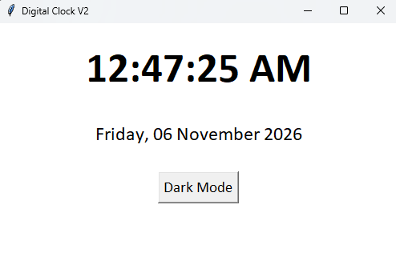

<div align="center">

# 🕒 DIGITAL CLOCK

### A Modern Desktop Clock Built with Python & Tkinter

**Simple • Elegant • Interactive • Beginner-Friendly**


*A small project. A meaningful step in my Python development journey.*

</div>

---

## ✨ About the Project

**Digital Clock** is a clean and interactive desktop application
developed entirely in **Python using Tkinter**.

This project demonstrates how Python can be used to build
real-time graphical applications with a simple and intuitive
user interface.

What started as a basic clock evolved into an interactive
application featuring theme customization and a full
date display.

> 💡 Built to practice Python GUI development, event handling,
> functions, and real-time interface updates.

---

## 📸 Project Showcase

### 🌙 Dark Mode

<div align="center">


*Minimal design with a dark background and clear typography.*

</div>

### ☀️ Light Mode

<div align="center">



*A bright, clean interface for comfortable viewing.*

</div>

## 🚀 Features

| Feature | Description |
|---------|-------------|
| 🕒 Real-Time Clock | Displays the current system time |
| 📅 Full Date Display | Shows day, date, month, and year |
| 🌙 Dark Mode | Modern dark interface |
| ☀️ Light Mode | Clean and bright interface |
| 🔄 Automatic Updates | Refreshes every second |
| 🎨 Simple UI | Minimal, readable design |
| 🖥️ Desktop Application | Runs locally using Python |

---

## 🛠️ Technology Stack

| Technology | Purpose |
|------------|---------|
| Python 3 | Core programming language |
| Tkinter | Graphical user interface |
| time.strftime() | Time and date formatting |
| Tkinter after() | Automatic clock updates |

**No third-party Python packages required.**

---

## 📂 Project Structure

```text
Digital_Clock/
│
├── Clock.py
├── README.md
│
└── screenshots/
    ├── dark_mode.png
    ├── light_mode.png
    └── demo.gif
```

---

## ⚙️ Installation & Usage

### 1. Clone the Repository

```bash
git clone https://github.com/YOUR_USERNAME/Digital_Clock.git
```

### 2. Navigate to the Project

```bash
cd Digital_Clock
```

### 3. Run the Application

```bash
python Clock.py
```

The Digital Clock window will open on your desktop.

**Requirements:**
- Python 3 installed
- Tkinter available in your Python installation
- A desktop environment

---

## 🧠 What I Learned

Building this application helped me understand:

- Python GUI development with Tkinter
- Creating and configuring windows
- Working with Label and Button widgets
- Writing and calling Python functions
- Understanding local and global variables
- Using conditional statements
- Handling button click events
- Formatting dates and times
- Scheduling updates with `after()`
- Changing widget properties dynamically

**This project strengthened my understanding of how
Python code interacts with graphical interfaces.**

---

## 🗺️ Future Development Roadmap

- [x] Real-time digital clock
- [x] Full date and day display
- [x] Dark and Light theme switching
- [ ] 12/24-hour format toggle
- [ ] Custom font and color selection
- [ ] Stopwatch
- [ ] Countdown timer
- [ ] Alarm clock
- [ ] World clock
- [ ] Save user preferences

More improvements are planned as I continue learning Python.

---

## 🤝 Feedback & Contributions

Suggestions and constructive feedback are always welcome.

If you have an idea to improve the application:

1. Open an Issue to share your suggestion.
2. Fork the repository.
3. Experiment with a new feature.
4. Submit a Pull Request.

---

## ⭐ Support the Project

If you find this project interesting or useful:

- Give the repository a **Star**
- Share it with other Python learners
- Suggest a feature for the next version

Your feedback motivates further learning and improvement.

---

<div align="center">

### Made with Python 🐍

**Learning • Building • Improving**

*Every great developer starts with small projects.*

</div>
